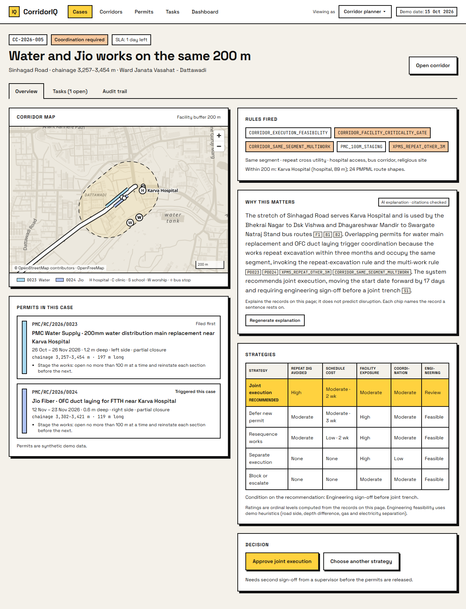
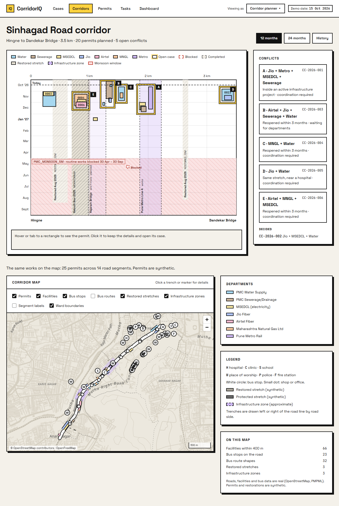
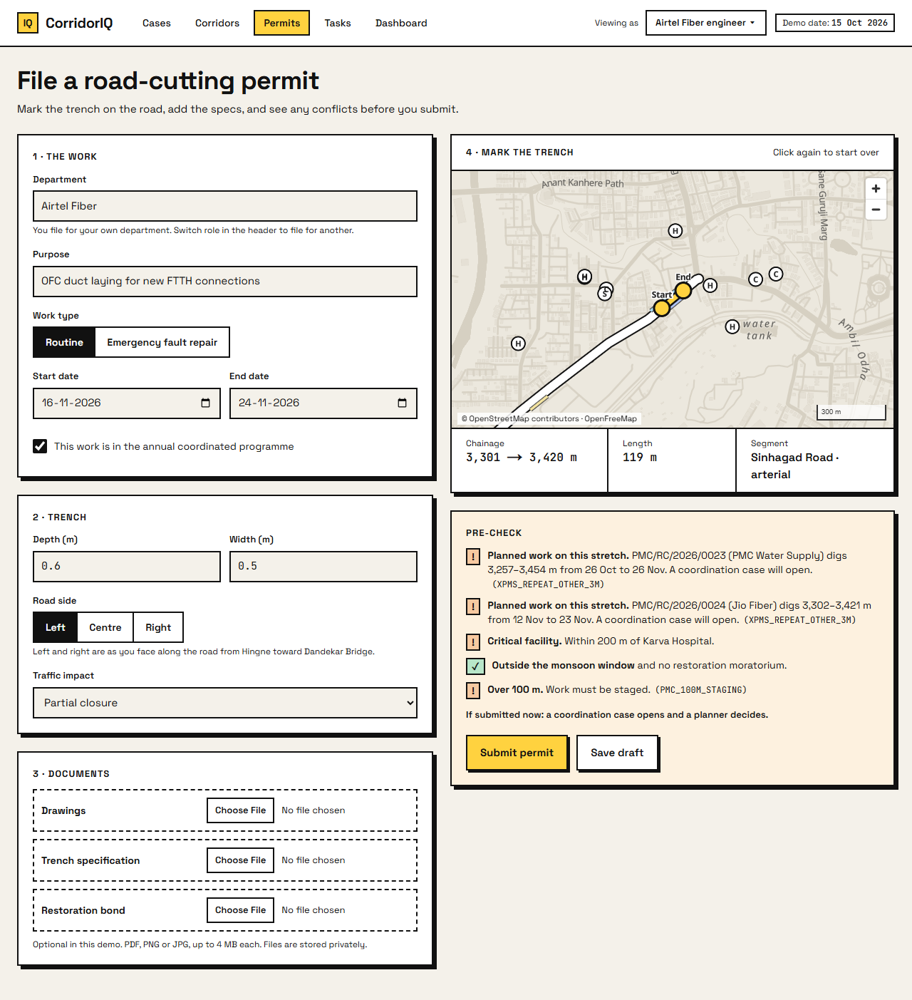
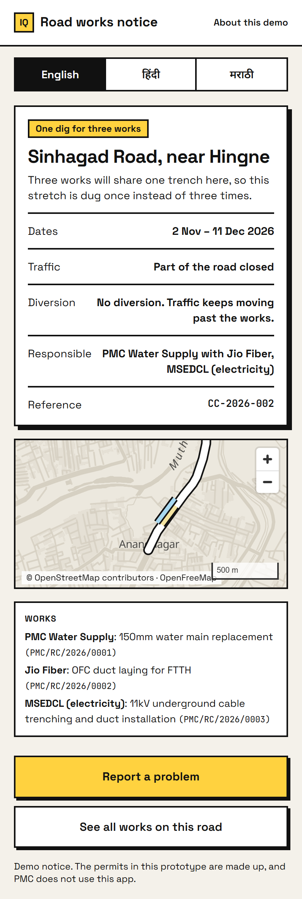
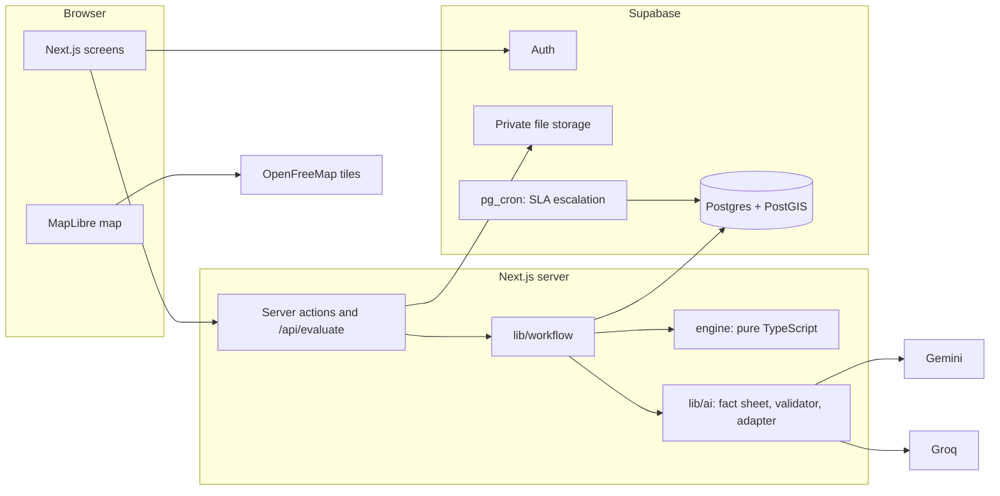

# CorridorIQ

**Development is planned department-wise. It is experienced corridor-wise.**

CorridorIQ is a prototype for coordinating road-cutting permits. It treats a stretch of road as one long-running case, so when two departments plan to dig the same place, a planner hears about it before the road is opened twice.

The demo runs on a real road: Sinhagad Road in Pune, from Hingne to Dandekar Bridge (3.5 km).

> This is a portfolio project. The permits are made up, and Pune Municipal Corporation does not use this app.



| The road over time | Filing a permit | The public notice |
|---|---|---|
|  |  |  |

## The problem

In Indian cities, the water, sewerage, electricity, gas, telecom and metro agencies each apply for permission to cut a road. Each permit is approved on its own. No department sees another's plans, so the same stretch gets dug, restored and dug again, and the hospitals, school routes and bus corridors along it take the disruption every time.

Sinhagad Road has a public record of this. A few examples, paraphrased, with links to the original reports:

- A freshly concreted part of the road was dug up again about two months later to lay utility cables. ([Indian Express, 30 Jun 2020](https://indianexpress.com/article/cities/pune/deadline-over-roaddiggers-still-send-traffic-into-a-spin/))
- Two city buses got stuck on a newly concreted stretch near Hingne Chowk after utility lines were moved, and the concrete had to be laid again. ([Times of India, Oct 2025](https://timesofindia.indiatimes.com/city/pune/pmpml-buses-get-stuck-on-newly-concreted-stretch-of-sinhagad-road/articleshow/124437290.cms))
- After water pipeline repairs, residents said the road was left badly restored and without warning barricades. ([Free Press Journal, 6 Dec 2024](https://www.freepressjournal.in/pune/infrastructure-issues-plague-sinhagad-road-absence-of-barricades-reflectors-and-speed-breakers-lead-to-traffic-woes))

Ten such records are in `data/raw/s8`.

## What CorridorIQ does

1. **An engineer files a permit.** They mark the trench on a map and add dates and depth. A live pre-check shows conflicts before they submit.
2. **A rules engine checks the whole stretch.** If the new permit overlaps planned or recent work in both place and time, the system opens a Coordination Case and holds the permit. Nothing with an open case is approved automatically.
3. **A planner decides.** They see which rules fired, five possible strategies with plain trade-offs (for example "repeat dig avoided: high, schedule cost: moderate, 2 weeks"), and a short explanation that cites the case records.
4. **A supervisor signs off.** The planner can override the recommendation, but only with a written reason. A second person approves or sends it back. Everything lands in an append-only audit log.
5. **Residents get one notice.** When works are joined, there is one notice for the stretch, in English, Hindi and Marathi, with a way to report a problem.

### Try it

After setup (below), open the app and click **Try the demo**. It signs you in as the planner and opens the hospital case: a water main and a fibre duct planned for the same 200 m beside Karva Hospital. Approve the recommendation, switch to Supervisor from "Viewing as" in the header, and sign off. The two works now share one dig and one public notice.

Other things to try:

| Screen | Path |
|---|---|
| All cases, sorted by time left to decide | `/cases` |
| The road over time: every permit by place and date | `/corridors` |
| File a permit with a live pre-check | `/permits/new?example=hospital` |
| What residents see | `/public/works` |
| Counts from the decisions made so far | `/dashboard` |
| Rule settings and demo reset (Administrator) | `/admin` |
| Pick any of the five roles | `/demo` |

## How the engine works

The engine is plain TypeScript in `engine/`. It imports nothing from the web framework or the database. It takes the new permit, the state of the corridor, the city's rules and a date, and returns a result. The same input always gives the same result.

It runs twelve steps:

| Step | What it checks | Rules |
|---|---|---|
| 1. Jurisdiction | Is the trench on a managed corridor? | |
| 2. Hard policy | Monsoon season, emergency repairs, long trenches, the annual programme | `PMC_MONSOON_5M`, `PMC_FAULT_48H`, `PMC_FAULT_MONSOON_5X1`, `PMC_100M_STAGING`, `PMC_ANNUAL_PROGRAMME` |
| 3. Road protection | Recently restored or protected road | `PMC_DLP_12M`, `PMC_CC_DLP_PRIOR_APPROVAL`, `CORRIDOR_RESTORED_12M`, `CORRIDOR_CRITICAL_MORATORIUM` |
| 4. Spatial | How close is each other work along the road, and on which side? | |
| 5. Temporal | How many days between the works? | |
| 6. Repeated opening | Has this place been opened recently, or will it be again soon? | `XPMS_REPEAT_SAME_6M`, `XPMS_REPEAT_OTHER_3M`, `XPMS_COMMON_TRENCH_3_6M` |
| 7. Execution feasibility | Could the works share one trench? | `CORRIDOR_EXECUTION_FEASIBILITY` |
| 8. Criticality | Hospitals, schools, bus routes and major projects nearby | `CORRIDOR_FACILITY_CRITICALITY_GATE` |
| 9. Strategy generation | Join, defer, resequence, keep separate, or escalate | `CORRIDOR_SAME_SEGMENT_MULTIWORK`, `MOHUA_UTILITY_COORDINATION` |
| 10. Trade-offs | A level for each strategy on five measures | |
| 11. Planner gate | Does a person need to decide? | |
| 12. Audit and notice | Record the result and draft the public notice | |

Three things worth knowing:

- **Rules are data.** Every threshold (90 days, 50 m, 12 months and so on) lives in the `rules` table. An administrator can change one on the Admin screen and see which open permits would come out differently.
- **Every finding names its rule.** There are no scores without a source.
- **Trade-offs are levels, not numbers.** The engine says "high" or "low". It never produces a percentage or a prediction.

Step 7 uses simple rules of thumb (road side, depth difference, gas next to electricity). They stand in for an engineer's judgement and the screen says so.

The engine has 64 tests, including one for each story in the demo. Run them with `npm test`.

## How the AI is used

The AI has one job: write three or four sentences explaining why a case matters.

- It sees only a **fact sheet** built from the case's own records. Every fact has an ID.
- Every sentence must cite those IDs. On screen they show as chips you can hover over.
- A **validator** rejects the text if a sentence has no citation, cites something that is not in the sheet, uses a number that is not in the sheet, runs too long, or uses forecasting words such as "likely", "estimate" or a percentage sign.
- If the first provider fails or its text is rejected, the second is tried once. If that fails too, a fixed template writes the explanation from the same facts. The page says which one wrote it.

Providers: Gemini (free tier) first, then Groq (free tier), then the template. With no keys at all, the app still works on the template.

The AI is called once when a case is created and when someone clicks Regenerate. It is never called just because a page was opened.

## Architecture



All spatial queries happen in `lib/db` before the engine runs. The browser never talks to the database: row-level security is switched on for every table with no policies, and the server checks the user's role before each action.

## Tech stack

| Area | Choice |
|---|---|
| App | Next.js (App Router), React, TypeScript |
| Styling | Tailwind CSS with custom tokens |
| Database | Supabase Postgres with PostGIS and pg_cron |
| Auth and files | Supabase Auth and Storage |
| Maps | MapLibre GL with OpenFreeMap tiles (no key needed) |
| Charts | Hand-built SVG with d3-scale; Recharts on the dashboard |
| Validation | zod |
| AI | Gemini, then Groq, then a fixed template |
| Tests | Vitest for the engine, AI and notices; Playwright for three browser flows |

## What is real and what is made up

| Data | Status | Source |
|---|---|---|
| Road line, hospitals, schools, shops | Real | OpenStreetMap |
| Bus routes and stops | Real | PMPML GTFS feed |
| Ward boundaries | Real | DataMeet municipal data |
| News evidence | Real, paraphrased and linked | The publications named above |
| Rules | Based on PMC's trenching guidelines, a Hong Kong road-works method (XPMS), a 2017 MoHUA advisory, and demo settings. Each rule lists its source | `data/raw/s6` |
| Infrastructure projects | Real projects; where they touch the road is approximate | `data/raw/s7` |
| **Permits** | **Made up** | Written for the demo |
| **Restored and protected stretches** | **Made up** | Written for the demo |

[`data/README.md`](data/README.md) describes each source and how the scripts process it.

### Licences

- OpenStreetMap data is under the ODbL. The maps credit "© OpenStreetMap contributors".
- The PMPML bus feed and the DataMeet ward boundaries have their own terms. Confirm them before reusing this data elsewhere.
- News articles are linked and paraphrased only.

## What is in this repository

| Folder | Contents |
|---|---|
| `app/` | Screens and API routes |
| `components/` | Map, charts, forms and shared interface parts |
| `engine/` | The rules engine and its tests |
| `lib/` | Database queries, workflow, AI layer, notices, sign-in |
| `config/` | City pack, departments, colours, feature switches |
| `data/` | Source data, processing notes and the processed files the seed reads |
| `scripts/` | Data processing, seeding and checks |
| `supabase/migrations/` | Database tables and functions |
| `tests/e2e/` | Browser tests |
| `assets/readme/` | The images on this page |

## Running it yourself

You need Node.js 20 or newer and a free Supabase project. The browser tests also need Google Chrome.

```bash
npm install
```

Copy `.env.example` to `.env.local` and fill in the Supabase values (project URL, publishable key, secret key, and the Session pooler connection string). The Gemini and Groq keys are optional. Then check the file:

```bash
npm run check:env
```

Create the tables and load the demo:

```bash
npm run db:migrate
```

```bash
npm run db:seed
```

Start the app:

```bash
npm run dev
```

Useful commands:

| Command | What it does |
|---|---|
| `npm run typecheck` | TypeScript check |
| `npm run lint` | ESLint |
| `npm run build` | Production build |
| `npm test` | Engine, AI and notice tests |
| `npm run test:e2e` | Three browser flows against the running app (resets the demo before and after) |
| `npm run data` | Rebuilds `data/processed` from `data/raw` and checks it |
| `npm run engine:report` | Prints the engine's result for every demo permit |
| `npm run db:verify` | Checks the seeded database against the engine |
| `npm run ai:explain` | Rewrites every case explanation and shows which provider answered |

The seed is repeatable. Running `npm run db:seed` again puts the demo back to its starting state, and so does the reset button on the Admin screen.

## Reusing it

The parts that change from one city to the next are kept apart:

| To change | Edit |
|---|---|
| City or road | `config/cities/` and `data/processed/` |
| Thresholds | The `rules` table, from the Admin screen |
| AI provider | `lib/ai/providers/` |
| Branding and colours | `config/brand.ts`, `config/theme.ts` |
| Which features show | `config/features.ts` |
| Another platform | `POST /api/evaluate?dry_run=1` takes JSON and returns the engine's result |

## Credits

Built by Sarah Puthran.
